# DUNL on rainfall and streamflow

A from-scratch rebuild of **Deconvolutional Unrolled Neural Learning (DUNL)**, applied to hourly rainfall and streamflow from a small catchment in Pennsylvania.

---

## 1. The problem

Streamflow is close to a **convolution**. Rain arrives in short bursts. The catchment turns each burst into a slow rise and fall of flow (the *unit hydrograph*). The flow we measure is the sum of many overlapping responses.

DUNL was built for neuroscience: spikes or fluorescence are a convolution of sparse events with a kernel. The same math fits hydrology, and there is a clear physical reading:

| DUNL (neuroscience) | This project (hydrology) |
|---|---|
| neuron, trial | basin, 30-day window |
| spike counts or ΔF/F `y` | streamflow `Q` (mm/h) |
| event onsets | hours with rain |
| sparse code `x` | effective rain (the part that becomes runoff) |
| kernel `h` | unit hydrograph (quick flow, slow flow) |
| baseline `a` | baseflow |

The questions:

1. Can DUNL learn a sensible unit hydrograph and per-storm amplitudes from flow?
2. When are the learned kernels **identifiable**, and when can wrong kernels fit as well as the true ones?
3. Do the per-event amplitudes help to predict flow from rain, compared with simpler baselines?
4. Can DUNL find *when* rain happened from flow alone (unknown support)?

## 2. The data

- **Source:** the small CAMELS-US test set that ships with the [`neuralhydrology`](https://github.com/neuralhydrology/neuralhydrology) package. The notebook downloads it from a pinned commit (`9528d1d1...`), so the data never changes. File sizes and SHA-256 hashes are logged.
- **Content:** hourly NLDAS forcing (rain, temperature, ...) and hourly USGS streamflow for 4 basins, 2000 to 2002 (26,304 hours). Rain and flow are both in mm/h.
- **Basin used:** `01547700`, Marsh Creek at Blanchard, PA. Small (114 km²), steep, fast response, 1.3% missing flow. Change `BASIN` in the notebook to try another one.
- **Season:** April to November, to stay away from snowmelt.
- **Trials:** 24 windows of 30 days (720 h), at most 10% missing flow. Rain from before each window is kept as context. A mask handles missing flow in the loss.
- **Split:** 2000 and 2001 for training (12 windows) and validation (4 windows), 2002 for testing (8 windows).

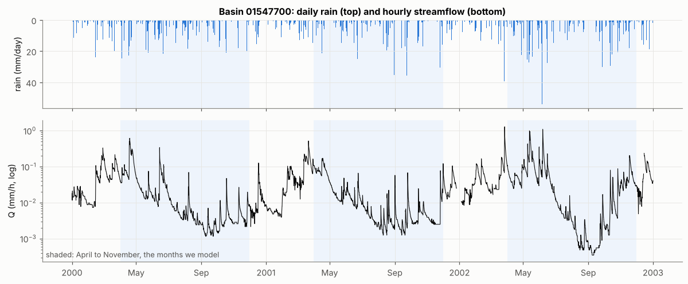

## 3. Reference paper

Tolooshams et al., "Interpretable deep learning for deconvolutional analysis of neural signals", *Neuron*, 2025. [Lab page](https://uchidalab.hsites.harvard.edu/publication/interpretable-deep-learning-deconvolutional-analysis-neural-signals).

> Full author list, volume and pages: to be checked before citing. Link to the authors' code: to be added.

This notebook rebuilds DUNL from its linear algebra (operators, step size, proximal maps, unrolled ISTA, training), adds a missing-data mask, and tests it against known answers on synthetic data before using real flow.

## 4. Why the problem is hard

Four short demos in the notebook (Section 3):

- **Responses overlap.** 67.6% of in-season gaps between storms are shorter than the 120 h kernel.
- **Averaging around events is biased.** Only 13 of 145 in-season storms are isolated. The all-storm average carries the tails of neighbouring storms.
- **Deconvolution is ill-conditioned.** For one test kernel, `cond(H) = 1.59e3`. Plain least squares gives error 2.43. With a sparse, non-negative prior (ISTA) the error is 0.71.
- **The response is not time invariant.** Storm runoff ratio rises with antecedent wetness (Spearman 0.39). This has to show up in the amplitudes, not the kernel shape.

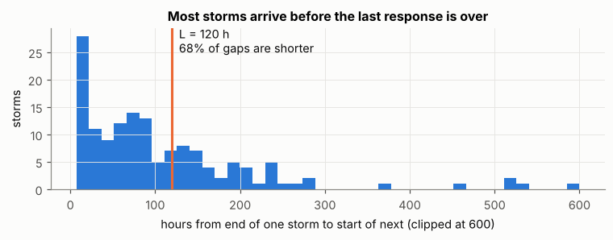
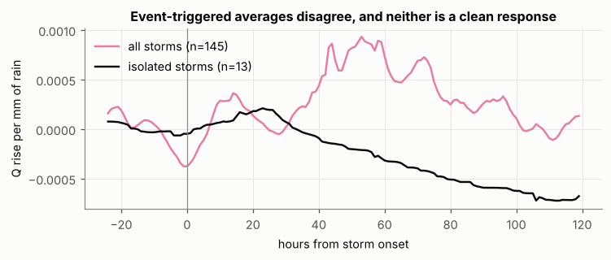
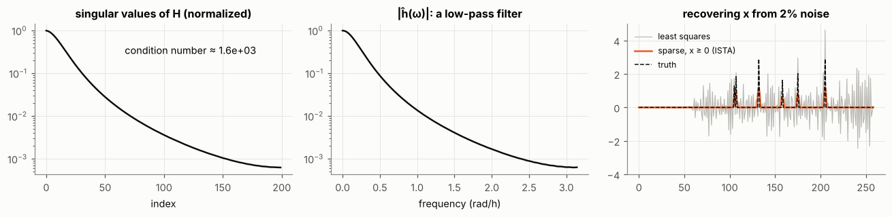

## 5. Main results

### 5.1 Method checks

- The operator `H` and its adjoint pass the adjoint test (error about 2e-13). The FFT version matches the direct one and is about 8x faster per `H`/`Hᵀ` pair.
- **Step size.** The safe ISTA step is `1/σ²`. The paper's text writes `1/σ`, which diverges here (final objective 2.5e4 against 2.0). The paper's algorithm estimates `σ²`, so this is probably loose notation. Worth checking against the authors' code.
- With known support, the right constant is `‖HE‖²`, which allows a larger step. At 20 layers it gives test NSE 0.952 against 0.939 for the full-operator step.

### 5.2 Ground truth on synthetic data

Real rain, synthetic flow from two known kernels (quick, slow) with shared support. Three cases differ in how much the two amplitudes vary from storm to storm.

| case | amplitudes | cosine to true (quick, slow) | verdict |
|---|---|---|---|
| coactive | fixed ratio | 0.98 to 0.99, 0.68 to 0.76 | not identifiable: wrong kernels fit as well as the truth |
| correlated | narrow cone | 0.98, 0.74 to 0.76 | not identifiable |
| scattered | spread to the edges | 1.00, 0.90 to 0.94 | recovered |

The check: plug the **true** kernels into a deep inner solve (1000 FISTA steps) and compare held-out loss. If the learned kernels fit as well as the truth, the data cannot tell them apart.

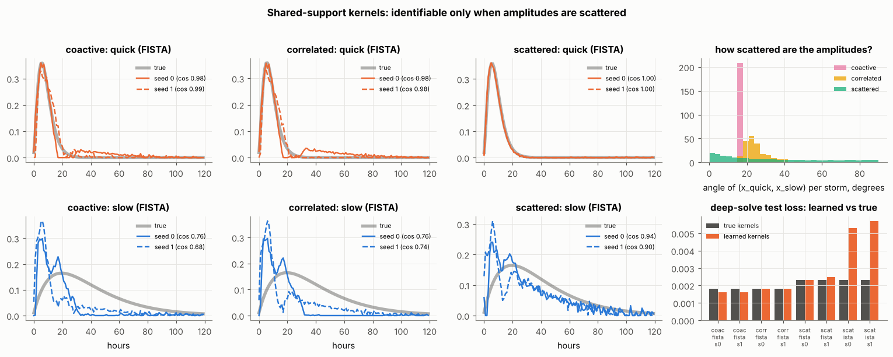

- **Truncation bias.** With a 60-step ISTA encoder the slow kernel is not recovered (the truth fits better, so this is an optimization failure). FISTA layers with the same depth and cost recover it.
- **Amplitudes.** Per-storm runoff coefficients from DUNL track the truth (Spearman 0.987, MAE 0.019). A fixed window does not (Spearman -0.092, MAE 0.797).

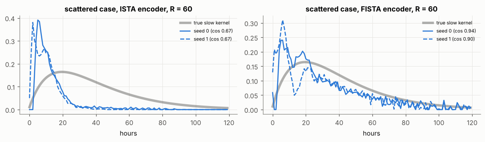

### 5.3 Real data, known support, one kernel

Codes are allowed only in rainy hours. Test NSE of the reconstruction is **0.964**. The learned unit hydrograph peaks at 7 h and has a long slow tail.

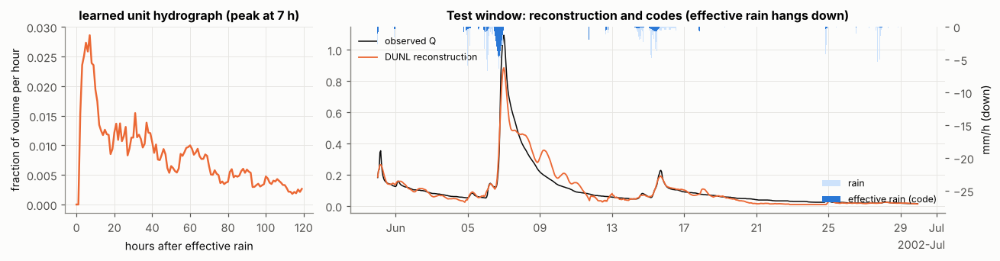

Per-storm runoff coefficients from DUNL codes relate more clearly to antecedent wetness than a fixed-window estimate does (Spearman **0.503** against 0.393, 140 storms).

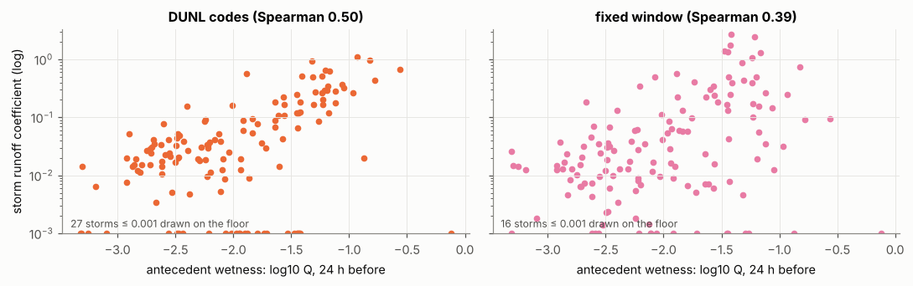

### 5.4 Two kernels (quick and slow flow)

Reconstruction improves (test NSE 0.995 to 0.997 over 3 seeds), but the kernels are **not stable across seeds**. Cosine similarity to seed 0 is 0.86 and 0.89 for seed 1, and 0.69 and 0.64 for seed 2. This matches the synthetic result: a split into quick and slow flow is a hypothesis here, not a measurement.

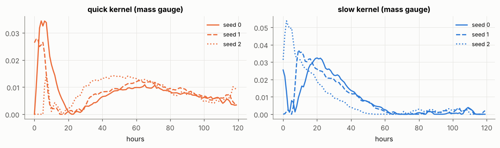

### 5.5 Parameter sweeps (K = 1, known support, test NSE)

| setting | values | test NSE |
|---|---|---|
| encoder depth `R` | 5, 20, 60, 150 | 0.923, 0.952, 0.964, 0.965 |
| kernel length `L` (h) | 48, 120, 240 | 0.949, 0.964, 0.970 |
| step (× 1/σ²) | 0.5, 0.9, 1.8, 2.5 | 0.964, 0.964, 0.966, 0.708 |
| ISTA vs FISTA layers (`R = 20`) | ISTA, FISTA | 0.952, 0.962 |
| gradient through encoder | yes, no | 0.964, 0.963 |

A step above 2 makes the inner solve diverge.

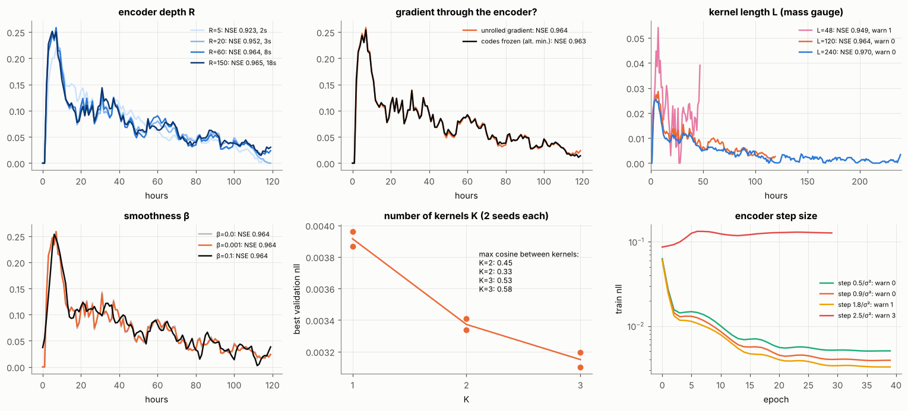

### 5.6 Prediction from rain (test year)

DUNL analyses flow, so its reconstruction cannot be compared with forecasts. The fair comparison predicts flow from rain only, with each method's kernel as the unit hydrograph.

| method | NSE | KGE |
|---|---|---|
| DUNL kernel + amplitude model (fit on DUNL codes) | **0.545** | **0.596** |
| DUNL kernel + amplitude model (fit end-to-end on Q) | 0.477 | 0.527 |
| GRU (black box, 12 training windows) | 0.229 | 0.190 |
| gamma (Nash cascade) | 0.196 | 0.037 |
| FIR non-negative | 0.195 | 0.037 |
| FIR ridge | 0.194 | 0.036 |
| DUNL K=2 kernels, fixed amplitude | 0.193 | 0.033 |
| DUNL K=1 kernel, fixed amplitude | 0.187 | 0.027 |

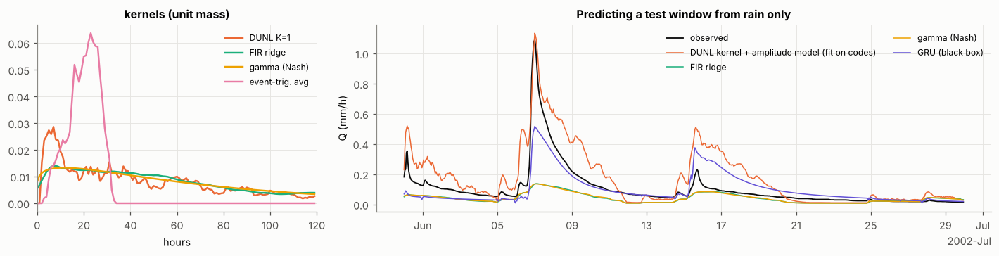

Kernel stability over 5 resamples of the training windows: DUNL mean pairwise cosine 0.953 (peak lag 5.8 ± 2.1 h), FIR ridge 0.960 (peak lag 9.4 ± 2.9 h). DUNL kernels are never negative.

### 5.7 Unknown support: find the events from flow alone

Reconstruction still works (test NSE 0.984 at λ/λmax = 0.03), but timing is weak. The codes come in bursts, and they sit about 11 h away from the rain because of the shift gauge (kernel starts late, or event happened late). Scored against storms that visibly raise the flow (106 of 208):

| method | F1 | precision | recall |
|---|---|---|---|
| peak finding on Q | **0.561** | 0.533 | 0.593 |
| DUNL, λ/λmax = 0.03 | 0.379 | 0.355 | 0.407 |
| DUNL, λ/λmax = 0.1 | 0.281 | 0.267 | 0.296 |

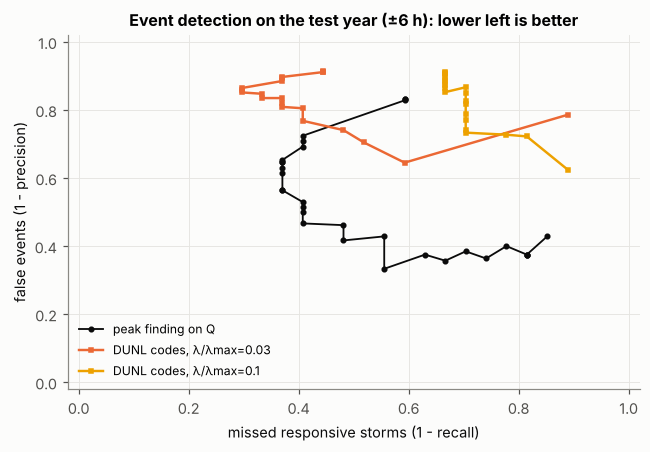

## 6. Conclusions

**On the method**
- Known-support DUNL acts like a bilinear model: a free kernel shape and a free amplitude per event. It recovers the quick kernel in every synthetic case and tracks storm amplitudes far better than a fixed window.
- **Identifiability of shared-support kernels is the central issue.** If the amplitudes of two kernels stay in a narrow cone, wrong kernels fit as well as the truth. A good fit says nothing about whether the parts are real.
- **Encoder depth biases what is learned.** A truncated ISTA encoder favours kernels that are easy to solve for, not the true ones. FISTA layers fix most of this at no extra cost.
- Unknown support works for reconstruction, but event timing is limited by the shift gauge. Here plain peak finding wins.

**On hydrology**
- The learned unit hydrograph peaks within hours, as expected for a small steep basin, with a long tail that one kernel cannot separate from baseflow.
- Event amplitudes depend on wetness and season. Models with a fixed amplitude cannot capture that. A small model fitted to DUNL's codes can, and this is where the prediction skill comes from.

**Limits**
- One basin, one site, three years, and only 12 training windows. The GRU result describes this small-data case only.
- Real-data tests have no ground truth. The synthetic tests are the proof, the real runs are evidence.
- Seed counts are small (2 to 3 per setting).
- 23 health-check warnings were logged in 45 runs (mostly "kernel tail may be too long, try a larger `L`"). Details are in each run's `warnings.txt` when the notebook is run.

**Next steps:** several gauges in one basin with group sparsity, a snowmelt input for Alberta basins, and a stronger state-dependent amplitude model.

## 7. Run it

The notebook runs on Colab or locally. It needs Python 3 with `numpy`, `pandas`, `scipy`, `matplotlib`, `torch`, `xarray` and `netCDF4` (the last two are installed by the first cell if missing). Training runs on CPU in a few minutes per run. The notebook needs internet access to download the data.

```
pip install numpy pandas scipy matplotlib torch xarray netCDF4 jupyter
jupyter notebook dunl_rainfall_runoff.ipynb
```

Each run writes logs, configs, metrics and figures under `runs_dunl/<timestamp>/`. To use your own hourly rain and flow series, see the appendix at the end of the notebook.

## Files

| file | content |
|---|---|
| `dunl_rainfall_runoff.ipynb` | full notebook with outputs |
| `figures/` | plots used in this README (taken from the notebook outputs) |
